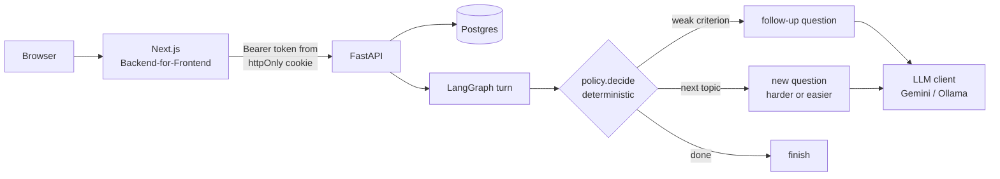
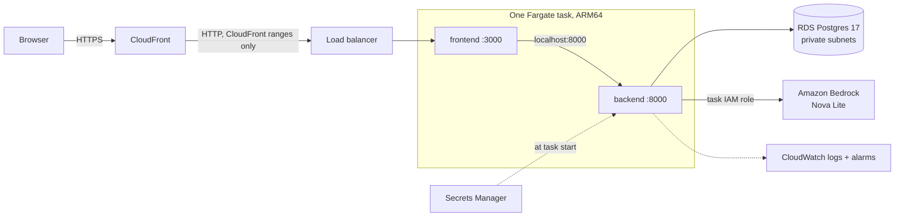

# AI Interview Coach

Practice interviews for software internships, graded against a rubric. Upload a resume and a job description, pick a mode (behavioral, project deep-dive or system design), and answer questions one at a time. Every answer gets a score per rubric criterion, a quote from your answer backing each score, and feedback. Weak answers get a targeted follow-up; strong ones move you to harder questions.


**Stack:** FastAPI, LangGraph, PostgreSQL, SQLAlchemy + Alembic, Next.js 16, Gemini, Amazon Bedrock or Ollama (local), AWS (ECS Fargate, RDS, CloudFront) with Terraform

## What it does

1. **Reads your resume and the job description** (PDF, DOCX or text) into small structured profiles: skills, projects, experience, requirements.
2. **Shows the skill gap** between them. It's computed in code, not by the model, and understands common aliases (k8s → Kubernetes, Postgres → PostgreSQL).
3. **Runs an interview** of up to 10 questions in one of three modes. Project questions are about the projects on your resume; system design starts with a system relevant to the role.
4. **Grades each answer** on five criteria for the mode, 1 to 5 each, with an exact quote from your answer as evidence for every score.
5. **Adapts:** a criterion scored 2 or lower earns one follow-up aimed at exactly that criterion; a strong answer (8+/10) makes the next topic harder, a weak one (4 or less) easier.
6. **Summarizes the session:** average per criterion, how much follow-ups helped on the criterion they targeted, the difficulty path, and the model calls, latency and estimated cost behind it.

| Mode | Criteria |
|---|---|
| Behavioral | Structure, Specificity, Ownership, Impact, Reflection |
| Project deep-dive | Problem framing, Technical depth, Trade-offs, Ownership, Results |
| System design | Requirements, High-level design, Scalability, Trade-offs, Communication |

## How a turn works



- **Code decides, the model writes.** Whether to follow up, move on or finish, and at what difficulty, is a pure function (`app/interview/policy.py`). The model only words the question and grades the answer.
- **Scores are computed, not asked for.** The model returns 1–5 per criterion; the overall 1–10 is computed from them. Evidence quotes are checked against the answer, and a quote that isn't in it is dropped.
- **Postgres is the only state.** LangGraph runs one turn per HTTP request with no checkpointer; the service rebuilds the turn's input from the database every time, so a restart loses nothing.

## Engineering decisions

Each one is written up in [`docs/decisions/`](docs/decisions/) with the alternatives and why they lost:

| # | Decision | In short |
|---|---|---|
| [001](docs/decisions/001-bounded-profile-no-vector-db.md) | Bounded structured profiles, no vector database | A resume and a job description fit in one prompt; retrieval would add moving parts for nothing |
| [002](docs/decisions/002-provider-independent-llm-interface.md) | Provider-independent LLM interface | One client owns retries with jittered backoff, a total time budget, usage and cost; providers only return raw facts. Cost is labeled an estimate and token counts are never invented |
| [003](docs/decisions/003-evaluation-as-release-gate.md) | Evaluation as a release gate | Grading quality is measured against human scores before a prompt or model change ships |
| [004](docs/decisions/004-stateless-langgraph-turns.md) | Stateless LangGraph turns | Includes a revision after the first real interview: follow-ups now cost one extra call because the grader's own follow-up asked about the wrong criterion |
| [005](docs/decisions/005-jwt-access-tokens-argon2id.md) | Short-lived JWTs, Argon2id passwords | Every route requires a user; each person sees only their own data |
| [006](docs/decisions/006-backend-for-frontend-httponly-cookie.md) | Backend-for-Frontend, httpOnly cookie | The browser never holds the token, so an injected script can't steal it |

## Evaluating the grader

Grading is the product's core claim, so it has its own harness ([`backend/evals/`](backend/evals/)): 18 answers written to probe specific failure modes (a strong STAR answer, a vague outcome, success claimed with no evidence, a design that skips requirements, an answer that tries to talk the grader into a high score), each graded 3 times.

First baseline, Gemini 3.5 Flash-Lite ([report](backend/evals/reports/20261014-221451_gemini-3.5-flash-lite.md)):

| Metric | Result |
|---|---|
| Gradings | 54 (18 cases × 3 repeats), 0 failed |
| Same score on every repeat | 88.9% of criterion scores |
| Hard limits on 8 cases (e.g. vague outcome → Impact ≤ 2, prompt injection → overall ≤ 4) | 24 of 24 held |
| Evidence quotes not found in the answer | 0.70 per grading, dropped automatically |
| Latency | p50 1.8 s, p95 5.3 s |
| Cost for the whole run | $0.069 (estimated) |

**What this does and doesn't show:** the grader is consistent and respects the hard rules, but agreement with a *person* isn't measured yet, so the gate's thresholds are still hypotheses (`evals/thresholds.json`). Next: blind human labels for the 18 cases (`python -m evals.label`), then agreement metrics (MAE, quadratic weighted kappa, bias) and thresholds set from human-to-human agreement.

## Run it locally

Needs Python 3.13+, Node 20+, Docker (for Postgres), and a Gemini API key or Ollama.

```bash
# 1. Database
docker compose up -d db

# 2. Backend
cd backend
python -m venv .venv && source .venv/bin/activate
pip install -r requirements.txt
cp .env.example .env          # set GEMINI_API_KEY (or LLM_PROVIDER=ollama) and JWT_SECRET
alembic upgrade head
uvicorn app.main:app --reload # http://127.0.0.1:8000, docs at /docs

# 3. Frontend (new terminal)
cd frontend
cp .env.example .env.local
npm ci
npm run dev                   # http://localhost:3000
```

Generate `JWT_SECRET` with `python -c "import secrets; print(secrets.token_urlsafe(48))"`. With `LLM_PROVIDER=ollama`, everything runs free and offline (`ollama pull llama3.2` first).

## Deploy to AWS

Terraform in [`infra/aws/`](infra/aws/) runs the whole app on AWS, sized for a short demo window: deploy, record, then `terraform destroy`.



| Piece | Choice and why |
|---|---|
| HTTPS | CloudFront's default certificate on a `*.cloudfront.net` name, so no domain is needed. The session cookie is `Secure` in production, so plain HTTP would break sign-in |
| Compute | One Fargate task (0.5 vCPU, 1 GB) holding both containers. The frontend reaches the API on `localhost`, so the API has no public route at all |
| Network | No NAT gateway (about $33 a month on its own): the task has a public IP, but its security group only admits the load balancer, which only admits CloudFront |
| Database | RDS Postgres `db.t4g.micro` in private subnets with no internet route, encrypted, SSL required; migrations run when the API container starts |
| Model | Amazon Bedrock (Nova Lite) through the Converse API, signed by the task's IAM role: no API key exists to leak. The role may invoke that one model only. `llm_provider = "gemini"` switches back to Gemini with its key in Secrets Manager |
| Secrets | Database URL and JWT secret generated by Terraform, stored in Secrets Manager, injected at start; never in the task definition |
| Alerts | Email for a monthly budget (50% and 100%), 5+ server errors in 5 minutes, and no healthy task for 5 minutes |
| Resumes | Not stored: uploads are parsed in memory, so there is no S3 bucket of personal documents to secure |

**Steps** (needs the AWS CLI signed in, Terraform 1.6+, Docker):

```bash
cd infra/aws
cp terraform.tfvars.example terraform.tfvars   # your email for alerts
./deploy.sh                                    # first run about 15 minutes; prints the URL
aws logs tail /ecs/interview-coach --follow    # watch it start
terraform destroy                              # when the demo is recorded
```

`deploy.sh` creates the image repositories, builds both images for ARM64 tagged with the commit, pushes them, then applies everything else; ECS rolls back by itself if the new task never turns healthy. Confirm the alert subscription from the email AWS sends. If Bedrock refuses the first call, enable access to Nova Lite under *Model access* in the Bedrock console.

**Cost while it runs:** roughly $0.10 an hour (load balancer, Fargate, RDS, public IPs) plus pennies of model use; Secrets Manager adds $0.40 per secret per month, prorated. Left running for a month it would be about $60, which is what the budget alert is for.

**Deliberate demo trade-offs**, each a setting away for real production: one task and a single-AZ database, no deletion protection and no final snapshot (so destroy is clean), AWS-managed encryption keys instead of customer-managed KMS keys, no WAF, no container insights, 14-day log retention. CI checks `terraform fmt` and `terraform validate` and builds both images on every push ([`deploy-checks.yml`](.github/workflows/deploy-checks.yml)).

## API

Every route except `/health`, `/ready` and `/auth/*` needs `Authorization: Bearer <token>`.

| Method | Path | What it does |
|---|---|---|
| POST | `/auth/register`, `/auth/token` | Create an account, sign in |
| POST | `/profiles/candidate`, `/profiles/job` | Upload a resume or job description |
| GET | `/profiles/gap` | Skill gap between a resume and a job |
| POST | `/sessions` | Start an interview (`mode`, profiles, `max_questions` 1–10) |
| POST | `/sessions/{id}/questions` | Next question: follow-up, new topic, or the end |
| POST | `/sessions/{id}/questions/{qid}/answer` | Submit and grade an answer |
| GET | `/sessions/{id}/summary` | Scores, follow-up effect, difficulty path, cost |

Errors come back as `{"detail": {"code", "message"}}`: 422 for an unreadable document, 502 when the model returns something unusable, 503 with `retryable: true` when the database or the model is down.

## Tests

```bash
cd backend && pytest -m "not integration"   # 217 tests, no database needed
cd backend && pytest -m integration         # 58 tests against Postgres
cd frontend && npm test                     # 32 tests
```

CI runs both suites on every push: the backend against Postgres 17, the frontend with lint, type check and a production build. Tests include a secret scan, access control (one user can't read another's interview), database-down behavior, and timing checks such as text extraction under 50 ms at p95.

## Project layout

```
backend/
  app/
    api/          routes: auth, profiles, sessions, health
    auth/         Argon2id passwords, JWTs
    ingest/       safe text extraction (size, page and zip-bomb limits)
    profiles/     structured resume and job profiles, skill gap, grounding check
    interview/    policy, LangGraph turn, questions, rubrics, grading, summary
    llm/          provider-independent client, Gemini, Bedrock and Ollama, prices, call recorder
    db/           SQLAlchemy models
  migrations/     Alembic
  evals/          grader evaluation: cases, blind labeling, runs, reports
  tests/
frontend/
  app/            pages, plus /api/auth and /api/backend (the Backend-for-Frontend)
  components/     upload steps, skill gap, interview screen, feedback, summary
docs/decisions/   architecture decision records
infra/aws/        Terraform for AWS and deploy.sh
```

## Known limits

- **Agreement with human graders isn't measured yet** (see above); until it is, scores are consistent, not proven accurate.
- **Text answers only.** Voice interviews (speech to text, text to speech) are planned, not built.
- **One resume and one job per interview,** by design (decision 001).
- **The AWS deployment is built for a demo window,** not for continuous production (see the trade-offs above).
